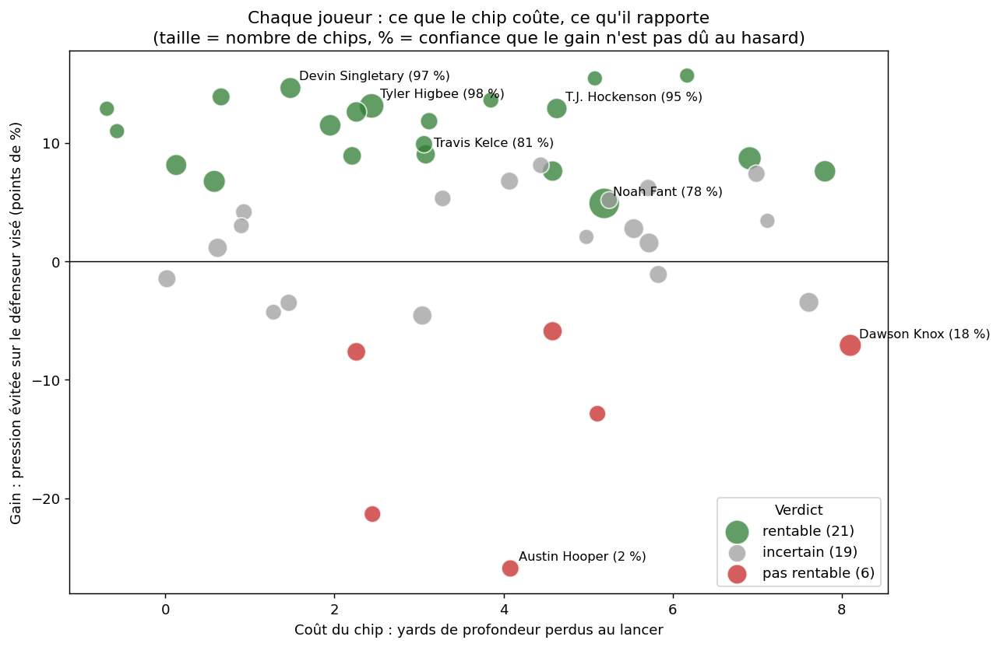
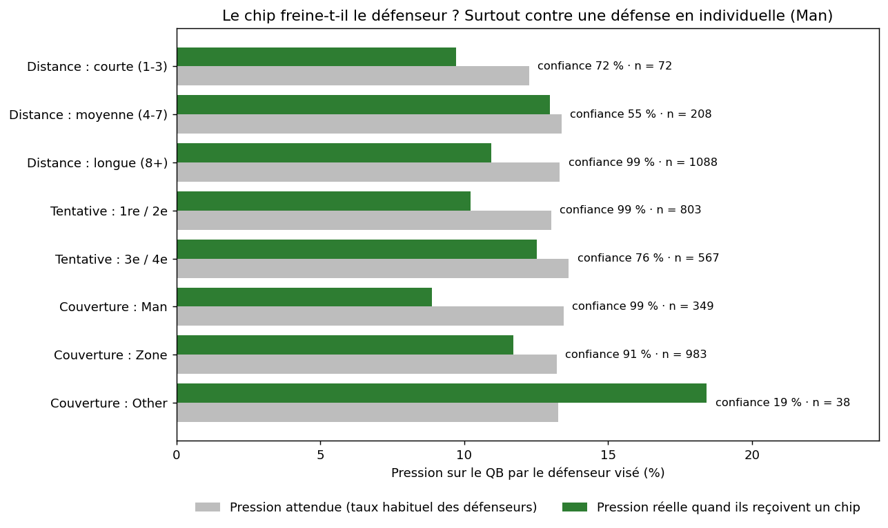
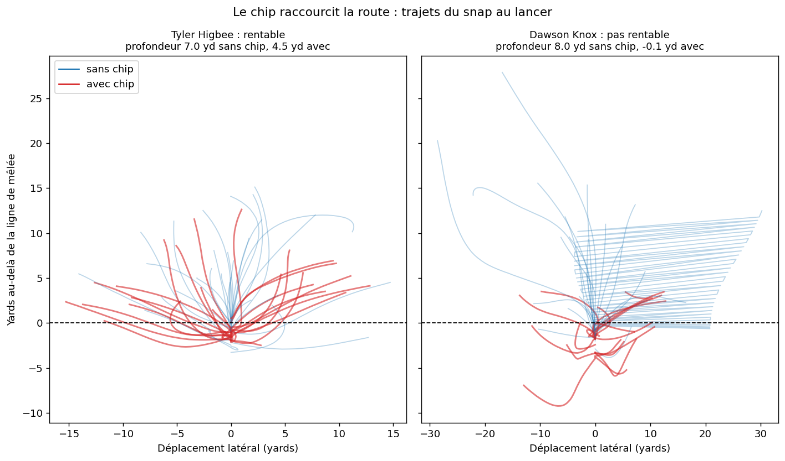

# 🏈 Le coût du chip

## L'idée

Sur une passe, un TE ou un RB peut faire un **chip** : bousculer le défenseur qui fonce sur le quarterback, puis partir en route. Nous avons mesuré cet échange sur 1 368 chips de la saison 2021 : **un chip coûte environ 5 yards de profondeur à un TE, et fait passer la pression du défenseur visé de 13,3 % à 11,2 %** (98 % de confiance que ce n'est pas le hasard). Le gain est net contre une défense en individuelle (+4,6 points, 99 % de confiance), mais il varie fortement d'un joueur à l'autre : Tyler Higbee a neutralisé ses défenseurs sur 26 chips, alors que ceux de Dawson Knox ont mis **plus** de pression que d'habitude. Notre outil donne au coach, pour chaque joueur, chaque situation et chaque défenseur adverse, un verdict chiffré avec son niveau de fiabilité et son explication.

## ✨ Ce que montre l'outil

- **Vue d'ensemble / Mon équipe** : tous les joueurs qui font des chips, avec un verdict ✅ rentable / ❌ pas rentable / ❓ incertain et le % de confiance, en un coup d'œil.
- **Fiche joueur** : le terrain avec ses trajets réels, 🔵 sans chip et 🔴 avec chip, pour *voir* le retard, avec les chiffres clés comparés et une phrase qui explique le verdict.
- **Situations** : la rentabilité du chip selon la distance à faire, la tentative et le type de couverture, pour savoir *quand* le déclencher.
- **Adversaire** : les défenseurs les plus dangereux de l'équipe adverse, leur côté vu par l'attaque, et ceux sur qui le chip marche. Exemple pour Cincinnati : Trey Hendrickson passe de 21 % à 8 % de pression quand il est chippé (à chipper), Sam Hubbard monte à 28 % (prévoir un vrai bloqueur).

Deux interfaces au choix, qui lisent les mêmes résultats : une **app web** (Streamlit) et une **app de bureau** (PySide6).

## 🔍 Ce qu'on a découvert

| Situation | Chips | Pressions attendues → réelles | Confiance que le chip aide | Coût en profondeur |
|---|---|---|---|---|
| **Défense en individuelle (Man)** | 349 | 46,9 → **31** | **99 %** | 4,7 yd |
| Défense en zone | 983 | 129,9 → 115 | 91 % | 4,7 yd |
| 1re / 2e tentative | 803 | 104,5 → 82 | 99 % | 4,7 yd |
| 3e / 4e tentative | 567 | 77,3 → 71 | 76 % | 5,0 yd |

| Joueur | Chips | Danger moyen des défenseurs visés | Pressions attendues → réelles | Coût | Confiance | Verdict |
|---|---|---|---|---|---|---|
| Tyler Higbee (TE, LA) | 26 | 13,1 % | 3,4 → **0** | 2,4 yd | 98 % | ✅ rentable |
| Noah Fant (TE, DEN) | 40 | 14,9 % | 6,0 → 4 | 5,2 yd | 78 % | ✅ rentable |
| Dawson Knox (TE, BUF) | 21 | 11,9 % | 2,5 → **4** | 8,1 yd | 18 % | ❌ pas rentable |

Sur les 251 joueurs qui ont fait au moins un chip, 46 en ont assez (10 ou plus) pour être jugés : **21 rentables, 6 pas rentables, 19 incertains**.

**À retenir pour un coach** : le chip coûte toujours environ 5 yards, mais il ne rapporte vraiment que contre l'individuelle et avec certains joueurs. Ailleurs, mieux vaut envoyer le receveur en route directe.







## 🧪 Méthode

Chaque joueur est jugé **par rapport à lui-même**, jamais par rapport à la moyenne des autres. Sinon, on mélangerait son talent et la qualité des défenseurs qu'il a croisés.

- **Coût (le receveur comparé à lui-même)** : sa profondeur (yards au-delà de la ligne de mêlée) et sa distance au défenseur le plus proche **au moment du lancer**, sur ses routes avec chip contre ses propres routes sans chip. Le tracking est normalisé pour que toutes les actions aillent dans le même sens.
- **Gain (le défenseur comparé à lui-même)** : le coach demande un chip face aux meilleurs défenseurs, donc comparer les actions avec et sans chip serait trompeur (on y voit *plus* de pression). On compare plutôt **chaque défenseur bousculé à son propre taux habituel** sur ses autres rushs (au moins 20). Chipper Myles Garrett (24 % de pression habituelle) ne crée pas la même attente que chipper un remplaçant à 9 %.
- **Fiabilité** : probabilité que la baisse de pression ne soit pas due au hasard (test de Poisson "mid-p" sur le nombre de pressions). Verdict ✅ à 75 % de confiance ou plus, ❌ à 25 % ou moins, ❓ entre les deux.
- **Ce que dit le verdict** : il répond à *"le chip de ce joueur protège-t-il vraiment le QB ?"*. Le coût en yards est affiché juste à côté, et c'est au coach d'arbitrer : un chip qui protège mais coûte 8 yards à son meilleur receveur n'est pas forcément le bon choix.

## 🚀 Comment lancer

```shell
pip install -r requirements.txt
streamlit run app.py     # app web : Vue d'ensemble, Fiche joueur, Situations, Adversaire
python -m gui            # app de bureau : Mon équipe, Fiche joueur, Adversaire, Situations
```

Les deux interfaces lisent **uniquement** les CSV légers du dossier `results/`. Pas besoin de retraiter les 811 Mo de données brutes pour les faire tourner.

Pour recalculer les CSV depuis les données brutes (environ 20 s), régénérer les figures du README, puis lancer les 92 tests :

```shell
python -m src.compute
python -m src.figures
python -m pytest
```

Les CSV produits sont identiques à l'octet près d'une version de pandas à l'autre.

## 📊 Les données

Jeu de données du NFL Big Data Bowl 2023 : tracking Next Gen Stats (position de chaque joueur 10 fois par seconde) combiné au scouting PFF (rôles, types de bloc, défenseur bloqué, pressions). Périmètre : semaines 1 à 8 de la saison 2021, 122 matchs.

## ⚠️ Limites

1. **Peu d'actions par joueur** : le chip reste rare, donc on ne juge que les joueurs avec au moins **10 chips**, et le % de confiance indique au coach quand un résultat peut encore être dû au hasard.
2. **Peu de WR** : ils ne font que 137 chips sur la période, le cœur de l'analyse porte donc sur les TE et les RB.
3. **Le tracking s'arrête au lancer** : on mesure la route jusqu'au lancer du QB, pas ce qui se passe après la réception. Les actions sans lancer (sacks, courses du QB) n'ont pas de mesure de profondeur, mais comptent pour la pression.
4. **Le coût en profondeur est en partie un choix d'appel** : un receveur qui fait un chip a souvent une route prévue courte. Les "5 yards" mélangent donc l'effet du chip et le type de route dessiné par le coach. Le biais est corrigé côté pression, pas encore côté coût.
5. **Comparer un défenseur à lui-même** neutralise son talent, mais pas tout le contexte de l'action (schéma de protection, temps de lancer). La confiance suppose aussi que son taux habituel est connu exactement : elle est donc un peu optimiste, surtout pour les joueurs avec 10 à 15 chips.
6. **Pas de classement entre joueurs** : "rentable" veut dire "son chip protège le QB", pas "il chippe mieux que les autres". Pour comparer, le coach regarde le tableau ou le nuage coût/gain, où tous les joueurs sont côte à côte.

## 🏗️ Architecture

```
data/ (brut)  →  src/compute.py  →  results/*.csv  →  app.py (Streamlit) / gui/ (PySide6)
                    (calculs)        le "contrat"         les interfaces
```

| Module | Rôle |
|---|---|
| `src/loading.py` | chargement des données et normalisation du sens de jeu |
| `src/selection.py` | routes TE / WR / RB avec et sans chip |
| `src/tracking.py` | profondeur, séparation et trajets au lancer |
| `src/pressure.py` | pression du défenseur bousculé contre son taux habituel |
| `src/reliability.py` | % de confiance et niveau de fiabilité |
| `src/summary.py`, `src/rushers.py`, `src/situation_stats.py` | fiches joueurs, défenseurs adverses et situations |
| `src/figures.py` | figures statiques du README (`figures/`) |
| `src/field.py`, `src/situations.py`, `app.py` | terrain, graphiques et app web |
| `gui/` | app de bureau |
